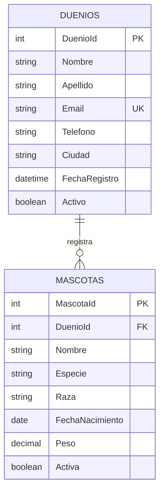
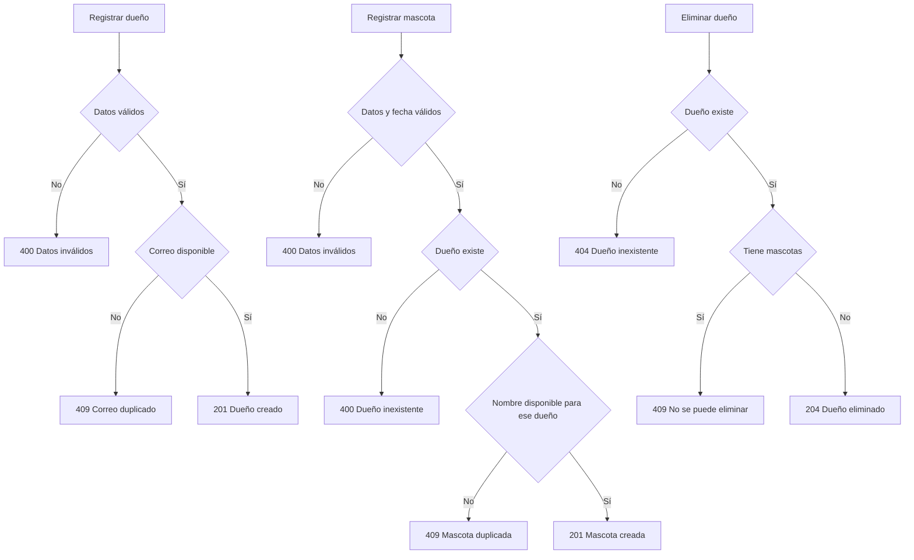

# VetHuellitas

## Explicación del tema

VetHuellitas resuelve el registro y control básico de los dueños y las mascotas de una clínica veterinaria. Permite consultar, crear, actualizar y eliminar información mediante una API REST documentada en Swagger.

Las entidades principales son Duenios y Mascotas. Un dueño puede registrar varias mascotas, mientras que cada mascota pertenece a un solo dueño. La relación es de uno a muchos y se mantiene mediante la clave foránea `DuenioId`.

Las reglas de negocio evitan correos duplicados, exigen que una mascota tenga un dueño existente, impiden repetir el nombre de una mascota para el mismo dueño y no permiten eliminar un dueño mientras tenga mascotas registradas. También se validan los campos obligatorios, el formato del correo, el teléfono, el peso y las fechas de nacimiento futuras.

## Observaciones y Conclusiones

El proyecto separa la API, la persistencia y la base de datos para que el mantenimiento sea más claro. EF Core conecta la aplicación con SQL Server y Swagger facilita probar cada endpoint antes de presentarlo.

La relación entre dueños y mascotas permite mantener datos consistentes. Las validaciones y restricciones de la base de datos complementan las reglas de la API y evitan registros inválidos o dependencias incompletas.

## Diagramas

- [Arquitectura de despliegue](.archify/architecture-despliegue-20261108-010000/arquitectura-despliegue.html)
- [Diagrama entidad-relación detallado](.archify/erd-entidad-relacion-20261108-010000/entidad-relacion.html)
- [Diagrama de reglas de negocio](.archify/workflow-reglas-negocio-20261108-011500/reglas-negocio.html)

### Entidad–relación en Mermaid

Para más detalles, revisa el [diagrama entidad–relación interactivo](.archify/erd-entidad-relacion-20261108-010000/entidad-relacion.html).

### Reglas de negocio en Mermaid

Para más detalles, revisa el [diagrama interactivo de reglas de negocio](.archify/workflow-reglas-negocio-20261108-011500/reglas-negocio.html).
